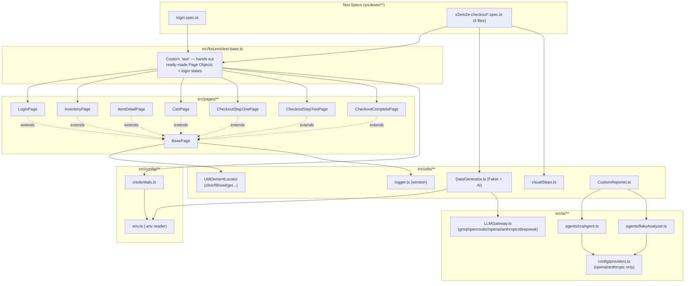
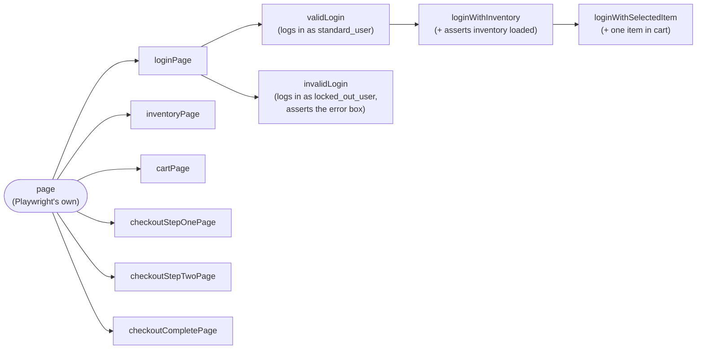
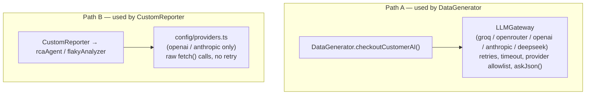
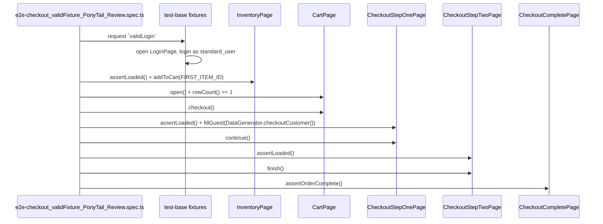
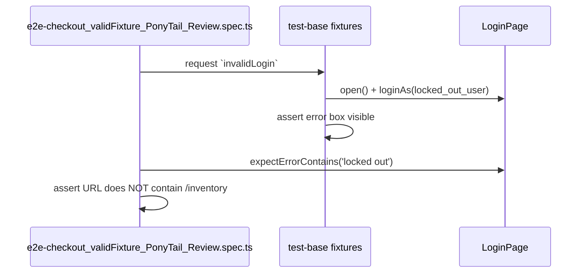
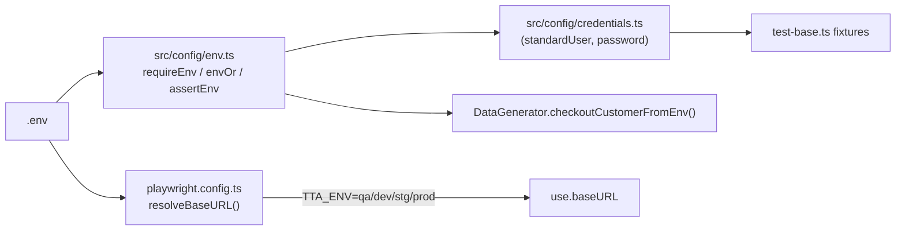

# Framework Architecture — Current State

This document explains **everything that exists in the framework right now**: what was added
since [`docs/CHANGES.md`](CHANGES.md) was last written, how the pieces connect, and a few gaps
worth knowing about. `CHANGES.md` is the historical log ("what happened, in order"); this file is
the map ("how it all fits together today").

---

## 1. Big picture



Four layers, bottom to top:
1. **Config** (`.env` → `env.ts` → `credentials.ts` / `playwright.config.ts`) — where every environment-specific value lives.
2. **Utils / AI** — generic building blocks nothing else in the app layer knows the details of (element actions, logging, fake data, the reporter, LLM calls).
3. **Pages** — one class per screen, all built on the same `BasePage` contract.
4. **Fixtures → Tests** — specs ask for a page or a login *state* by name; `test-base.ts` is the only place that knows how to build one.

---

## 2. What's new since the last log entry

`docs/CHANGES.md` left off with the project running a single `login.spec.ts` against a hand-built
`BasePage`. Since then, the framework grew a full checkout flow, a fixtures layer, fake-data
generation, and a multi-provider LLM gateway. New files, grouped by role:

| Area | New file | What it does |
|---|---|---|
| **Page Objects** | `src/pages/ItemDetailPage.ts` | Single product page (`inventory-item.html`): add/remove from cart, read name/price, `openById(id)`. |
| | `src/pages/CheckoutStepOnePage.ts` | Guest-details form (first name / last name / postal code) → `continue()` / `cancel()`. |
| | `src/pages/CheckoutStepTwoPage.ts` | Order overview — reads `subtotal()`/`tax()`/`total()`, `finish()`/`cancel()`. |
| | `src/pages/CheckoutCompletePage.ts` | Final confirmation screen — `assertOrderComplete()`, `confirmationText()`, `backHome()`. |
| **Element helper** | `src/utils/UtilElementLocator.ts` | Replaces the earlier `elementActions.ts` stub (now dead code — see §5). Accepts a selector *string or* an already-built `Locator` (the `Flex` type), adds `doubleClick`, `rightClick`, `hover`, `getAttr`, `isChecked`, `selectByText/Value/Index`, `waitForPageLoad`, etc. |
| **Logging** | `src/utils/logger.ts` (rewritten) | Now exports a shared root `logger` **and** `createLogger(scope)`; writes to `logs/combined.log` (was `reports/framework.log`). |
| **Fixtures** | `src/fixtures/test-base.ts` | A custom `test` (wraps Playwright's `base.extend`) — see §3. |
| **Fake data** | `src/utils/DataGenerator.ts` | Faker-backed credentials/contact/checkout data, plus an **AI-generated** checkout customer path via `LLMGateway`. |
| | `src/testdata/logintestdata.json` | The 6 TTACart demo accounts (`standard_user`, `locked_out_user`, `problem_user`, `performance_glitch_user`, `error_user`, `visual_user`) consumed by `test-base.ts`. |
| **Reporting** | `src/utils/visualSteps.ts` | A `test.step()` wrapper that optionally screenshots each step for the TTA report (`ATTACH_SCREENSHOTS=true`). |
| **Config** | `src/config/env.ts` | `requireEnv`, `envOr`, `assertEnv` — the one place that reads `.env`. |
| | `src/config/credentials.ts` | TTACart login creds, sourced through `env.ts`. |
| **AI** | `src/ai/LLMGateway.ts` | A full multi-provider LLM client (new — see §4). |
| **Tests** | `src/tests/e2e/*.spec.ts` (4 files) | The checkout flow, written four times at increasing sophistication — see §6. |

---

## 3. The fixtures layer (`test-base.ts`)

Before, every spec did `new LoginPage(page)` itself. Now specs import a **custom `test`** from
`@fixtures/test-base` and just *ask* for what they need:

```ts
import { test, expect } from '@fixtures/test-base';

test('...', async ({ validLogin, inventoryPage, cartPage }) => { ... });
```

Fixtures build on each other — `loginWithSelectedItem` needs `loginWithInventory`, which needs
`validLogin`, which needs `loginPage`:



Plain page-object fixtures (`loginPage`, `inventoryPage`, `cartPage`, the two checkout-step pages,
`checkoutCompletePage`) just hand back a `new XPage(page)` — no navigation. The **state** fixtures
(`invalidLogin`, `validLogin`, `loginWithInventory`, `loginWithSelectedItem`) actually perform setup
*before* the test body runs, only when a test asks for them by name — Playwright only runs the
setup for fixtures a test actually destructures.

> ⚠️ **Gap:** `TestFixture` (the type) declares `itemDetailPage: ItemDetailPage`, but the
> `base.extend({...})` object below it never implements it. No current spec asks for
> `itemDetailPage`, so this is silent today — but the first test that does will fail at runtime
> with "fixture not registered" even though `tsc` doesn't flag it. Worth adding a
> `itemDetailPage: async ({ page }, use) => use(new ItemDetailPage(page))` entry whenever that
> page object gets used.

---

## 4. The AI layer — two parallel implementations

There are now **two separate** LLM-calling code paths, and they are not yet the same one:



- **`LLMGateway.ts`** (new, bigger) backs `DataGenerator.checkoutCustomerAI()` — it supports 5
  providers, retries on 429/5xx, a company allowlist (`LLM_ALLOWED_PROVIDERS`), and an
  `askJson()`/`askJsonToFile()` API.
- **`src/ai/config/providers.ts` + `agents/rcaAgent.ts` + `agents/flakyAnalyzer.ts`** still use the
  original, simpler implementation (2 providers, no retry) wired up for the "AI Verdict"/"Flaky"
  report tabs.

Neither is broken — they're just two independent systems that happen to both call an LLM. If you
want the reporter's RCA/flaky tabs to support Groq/OpenRouter/DeepSeek too (e.g. the free tiers),
that means pointing `rcaAgent.ts`/`flakyAnalyzer.ts` at `LLMGateway` instead of `providers.ts` —
not done yet, flagging it here rather than changing it unasked.

> ⚠️ **Gap:** `DataGenerator.checkoutCustomerAI()` reads a prompt from
> `src/ai/prompts/checkoutCustomer.prompt.md` — that file/folder doesn't exist yet. The method
> isn't called from any current spec, so this hasn't broken a test, but it will throw
> (`ENOENT`) the moment something calls it.

---

## 5. Dead code: `elementActions.ts`

`src/utils/elementActions.ts` (the original `ElementActions` class) is no longer imported by
anything — `BasePage` now builds its `this.el` from `UtilElementLocator` instead:

```ts
// src/pages/BasePage.ts
import { UtilElementLocator } from '@utils/UtilElementLocator';
...
this.el = new UtilElementLocator(page, scope);
```

`elementActions.ts` still compiles, it's just unreachable. Safe to delete whenever you want — not
removed here since you didn't ask for a cleanup pass.

---

## 6. The checkout E2E spec — four stages of the same test

`src/tests/e2e/` holds the *same* checkout scenario written four times, each version adding one
idea on top of the last (clearly a working-through-it progression, not four separate features):

| File | Login | Reporting |
|---|---|---|
| `e2e-checkout.spec.ts` | `beforeEach` manually calls `loginPage.open()` + `loginAs()` | Plain `test.step`-free code |
| `e2e-checkout-with-visualStep.spec.ts` | Same manual `beforeEach` login | Wrapped in `visualStep(...)` for per-step screenshots |
| `e2e-checkout_validFixture.spec.ts` | Switched to the `validLogin` / `invalidLogin` **state fixtures** (no more `beforeEach`) + added the locked-out-user test | `visualStep(...)` throughout |
| `e2e-checkout_validFixture_PonyTail_Review.spec.ts` | Same as above | Same, with tidied-up comments (the "review" pass) |

The final version's actual flow:



Plus one independent negative test in the same file:



Because `playwright.config.ts` has `fullyParallel: true`, these two tests run in **separate
workers at the same time** — so the short "locked-out" test routinely finishes (and logs) before
the longer 5-step checkout test, even though it's declared second in the file. (Covered in more
detail earlier in conversation — not a bug, just how parallel scheduling reports things.)

---

## 7. Config resolution, end to end



`.env` now documents every knob the framework reads (environment selection, demo-login overrides,
`ATTACH_SCREENSHOTS`, optional fixed checkout customer, LLM provider/keys/allowlist, optional
MySQL data-driven-test config) — see the file itself for the full annotated list.

> ⚠️ **Gap:** `.env`'s first line says `# Copy to .env and fill in: cp .env.example .env`, and a
> later comment references `src/tests/apiTests` (Restful Booker login tests) — neither
> `.env.example` nor an `apiTests` folder exists yet. Both read as "planned next," not broken.

---

## Quick Reference — files this document is about

**New since `CHANGES.md`'s last entry:**
- `src/pages/ItemDetailPage.ts`, `CheckoutStepOnePage.ts`, `CheckoutStepTwoPage.ts`, `CheckoutCompletePage.ts`
- `src/utils/UtilElementLocator.ts`, `DataGenerator.ts`, `visualSteps.ts`
- `src/fixtures/test-base.ts`
- `src/config/env.ts`, `credentials.ts`
- `src/ai/LLMGateway.ts`
- `src/testdata/logintestdata.json`
- `src/tests/e2e/e2e-checkout.spec.ts`, `e2e-checkout-with-visualStep.spec.ts`, `e2e-checkout_validFixture.spec.ts`, `e2e-checkout_validFixture_PonyTail_Review.spec.ts`

**Rewritten:**
- `src/utils/logger.ts` (scoped child loggers, `logs/combined.log`)
- `src/pages/BasePage.ts` (now builds `this.el` from `UtilElementLocator`, not `ElementActions`)
- `.env` (full multi-environment + LLM + optional MySQL config)

**Now dead code (not removed, flagged only):**
- `src/utils/elementActions.ts`

**Known gaps (not fixed, flagged only):**
- `itemDetailPage` fixture declared but not implemented in `test-base.ts`
- `src/ai/prompts/checkoutCustomer.prompt.md` referenced but missing
- `rcaAgent.ts`/`flakyAnalyzer.ts` still on the smaller `providers.ts`, not yet on `LLMGateway`
- `.env.example` and `src/tests/apiTests/` referenced in comments but not present
